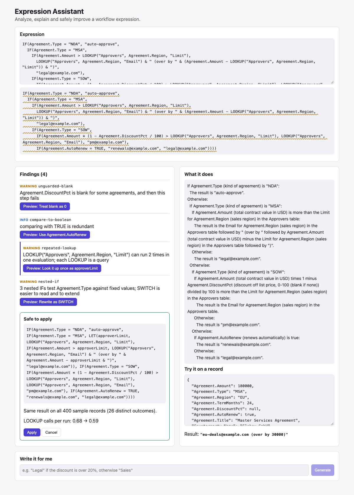

# exprassist: An AI Assistant for Workflow Expressions

Contract workflow tools let authors write formulas that route an agreement, compute a value or pick a branch:

```text
IF(Agreement.Type = "MSA",
   IF(Agreement.Amount > LOOKUP("Approvers", Agreement.Region, "Limit"), LOOKUP("Approvers", Agreement.Region, "Email"), "legal@example.com"),
   ...)
```

These expressions grow into nested, repetitive, fragile logic. exprassist is an assistant panel for them:
- **Analyze:** a static analyzer finds anti-patterns, performance problems and bugs waiting to happen, with a
  one-click fix for most.
- **Verify every fix before offering it.** The original and the fixed expression run on hundreds of sample
  records. A fix is called safe only if every result matches, and the panel reports whether it makes lookups more
  or less frequent.
- **Explain** what an expression does, in plain English, straight from the syntax tree.
- **Write it for me:** a local LLM turns a plain-language request into an expression. Its answer is only accepted
  once it parses, type-checks and passes the analyzer; otherwise the exact errors go back to the model.

Everything is TypeScript: a hand-written parser (Pratt), type checker and evaluator for the language, the
analyzer and verifier, and a React panel. Only generation needs a model (Gemma 4 through Ollama, run locally).



## What the analyzer catches

| Rule | Example | Fix |
|---|---|---|
| `nested-if` | `IF(Type = "NDA", 1, IF(Type = "MSA", 2, IF(Type = "SOW", 3, 4)))` | `SWITCH(Type, "NDA", 1, "MSA", 2, "SOW", 3, 4)` |
| `repeated-lookup` | a `LOOKUP` that runs twice in one evaluation | compute it once with `LET`, scoped as tightly as possible |
| `impossible-value` | `Agreement.Region = "Europe"` (values are NA, EU, APAC, LATAM) | `= "EU"` |
| `unguarded-blank` | `Amount * (1 - DiscountPct / 100)` when the discount can be blank | `COALESCE(DiscountPct, 0)`, flagged for review because behavior changes |
| `switch-on-number` | `SWITCH(Amount, 10000, "Tier 1", ...)` used as if it meant ranges | (explains to use `IF` with `<`) |
| `compare-to-boolean`, `if-returns-boolean`, `double-negation` | `AutoRenew = TRUE`, `IF(c, TRUE, FALSE)`, `NOT(NOT(x))` | `AutoRenew`, `c`, `x` |
| `constant-condition` | `IF(FALSE, a, b)` | `b` |
| type errors, unknown fields and functions, wrong argument counts | `LEN(Agreement.Amount)`, `Agreement.Amout` | did-you-mean for fields |

**How verification works.** Sample records come from the schema and from the expression itself. Every literal a
field is compared with is tried, along with the numbers just above and below each threshold, enumerated values, and
blanks for optional fields, so the samples reach every branch. On the demo expression, 400 samples reached 26
distinct outcomes.

## Findings from building it

**The verifier caught my own "optimization" making things slower.** The first `repeated-lookup` fix hoisted every
repeated `LOOKUP` into a `LET` at the top of the expression. The verifier showed lookups per evaluation going *up*,
from 0.59 to 1.09: the two copies sat in different branches of an `IF`, so only one ever ran, and hoisting forced
every evaluation to pay for it. The rule now flags copies only when two can run in the same evaluation, and places
the `LET` around the smallest enclosing expression. On the demo expression, lookups now fall from 0.68 to 0.59 per
evaluation with identical results.

**A test caught fixes that silently did nothing.** The tree rewriter called the fix callback on rebuilt copies of
each node, so a fix that targeted a node by identity never matched. The IF-to-SWITCH rewrite returned the
expression unchanged, and the verifier called it "safe," since nothing had changed. The rewriter is fixed, and the
verifier now reports "the fix leaves the expression unchanged" instead of "safe."

**Generation: checks help only when the error message says what to do.** Each request comes with test records and
expected results; an expression counts as correct only if every result matches.

| | Model's first answer | With checks and error feedback (up to 3 tries) |
|---|---|---|
| 20 requests, first version | 16/20 correct | 16/20: retries didn't help |
| same 20, improved feedback | 16/20 | **18/20** |
| 10 new requests written after the changes | 8/10 | 8/10 |

- **Retries first changed nothing.** The model kept writing `a OR b`. The parser's error, "unexpected input after
  the expression," didn't say what to change, so the model repeated itself three times. Now the error reads
  "OR is a function here: write OR(a, b) instead of a OR b," and the model fixed it on the next try.
- **A warning, sent back to the model, fixed a logic error.** The model had used `SWITCH(Amount, 10000, "Tier 1", ...)`
  for ranges. The new `switch-on-number` warning went back, and the model rewrote it with `IF` and `<`.
- **On the 10 new requests, the checks caught one invalid answer but couldn't rescue it.** The model called a
  `TEXT` function that doesn't exist, then `STR`, then `TO_TEXT`. The other failure was a misplaced parenthesis
  that passes every check: `(1 - COALESCE(DiscountPct, 0)) / 100` instead of `1 - COALESCE(DiscountPct, 0) / 100`.
- **No static check catches a wrong-but-valid expression.** That is why the panel always shows the result on a
  sample record before anything is applied.

The 20 development requests shaped the feedback changes, so they overstate the gain. The 10 new requests are the
fair measure, and there the checks made no difference to accuracy; they only ensured that nothing invalid was
returned.

## Run it

```bash
npm install
npm test                       # 15 tests, no model needed
npm run build && npm run server   # the panel at http://localhost:5174; generation needs Ollama + gemma4
npm run eval -- cases          # or: npm run eval -- holdout
```

## Design notes

- **Explanations come from the syntax tree, not the LLM.** They can't describe something the expression doesn't
  do, and they cost nothing.
- **The model never writes into the expression directly.** Its answer is a proposal that must parse, type-check
  and pass the analyzer, and the author still applies it.
- **Comparisons with a blank are false, not errors,** as in most formula languages. Arithmetic and text functions
  on a blank are errors, which is what the `unguarded-blank` rule protects against.
- **The server is small and conservative:** request bodies are capped, static files are confined to `dist/`, and it
  listens only on localhost.

## Limitations

- The language, schema and sample agreements are my own design, modeled on formula languages in workflow tools,
  not taken from a real product. Real workflow expressions would show which anti-patterns actually matter.
- Verification samples records; it doesn't prove equivalence. A difference that only shows up on a record the
  sampler never generates would be missed. Seeding samples from the expression's own literals makes that less
  likely, not impossible.
- 30 generation requests is a small test; it shows where the failures are, not precise accuracy.

Built with AI assistance (Claude Code). I reviewed the code; the tests, the verifier and the evaluation are how I
checked it, and they caught the bugs described above.
